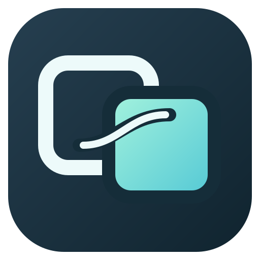
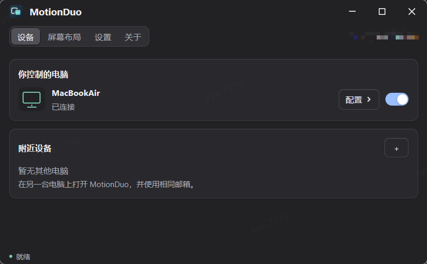
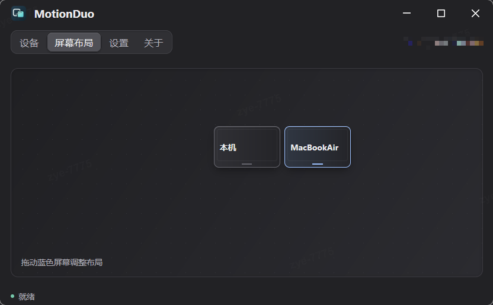

<h1>
  
  &nbsp;MotionDuo
</h1>

**面向 Windows 与 Mac 日常协作改造的局域网键鼠共享工具。**

使用一套键盘和鼠标控制多台电脑，将鼠标移动到屏幕边缘即可切换设备。它属于软件 KVM，不传输屏幕画面，也不是远程桌面工具。

[下载最新版本](https://github.com/alvin-7/motionduo/releases/latest) · [本分支改造](#本分支改造) · [开始使用](#开始使用) · [配置说明](#配置说明) · [开发与验证](#开发与验证)

## 界面展示

### 设备



### 屏幕布局



## 项目来源与定位

MotionDuo 是本分支的新显示名称和双屏流线图标；它不是上游图标。程序使用 `motionduo` 和 `motionduo-ui` 可执行文件；为兼容旧版本，配置和信任数据路径、协议标识、Windows 安装目录及 macOS bundle ID 保留原名。单实例锁保留旧身份；请勿同时手动启动不同安装副本。

本仓库是 **[jondkinney/mousehop](https://github.com/jondkinney/mousehop) 的二次改造分支**，以其 0.17.1 版本代码为基础继续开发。Mousehop 上游本身源自 Ferdinand Schober 及贡献者维护的 **[lan-mouse](https://github.com/feschber/lan-mouse)**。

```text
lan-mouse → jondkinney/mousehop → alvin-7/motionduo（本仓库）
```

本项目沿用上游的 Rust 多平台输入后端、设备授权与加密通信等基础能力，重点改造 **Windows ↔ Mac 的可靠输入、按键释放、触控板体验、网络变化处理与安装交付**。当前分支使用 MyGo 替换原有 GTK 界面。它不是全新独立实现，也不是上游的官方发行渠道。

原始作者和上游贡献者的署名及许可证保持不变，详见 [NOTICE](NOTICE) 与 [LICENSE](LICENSE)。

## 主要功能

- **跨屏共享键鼠**：按设备配置屏幕相对位置，支持自动跨屏、按住指定修饰键后跨屏和强制释放快捷键。MyGo 设置可分别选择左右修饰键与触发键，并设置墙边兜底释放阈值；阈值为 0 仅关闭兜底，不禁用快捷键。
- **图形化管理**：紧凑的 MyGo 原生界面，默认 680×420；设备行的配置按钮就地展开该设备的选项，全局低频选项收进高级设置，屏幕通过拖拽吸附调整。不保留 GTK 回退；命令行和独立后台服务继续保留。跨平台原生体验仍待验收。
- **局域网发现与授权**：同邮箱 mDNS 发现设备；接收端点击同意后授权实际设备证书，日常界面不展示指纹，通过 DTLS 加密网络通信。邮箱不提供控制权限，也不是云账号。拒绝、请求过期或撤销授权后，发起端持久暂停请求，需点击“重新请求”才能再次邀请；已授权设备的普通网络断线仍可自动恢复。未授权连接仅进入有界、60 秒有效的独立授权通道，不能传递键鼠或剪贴板；接受后须重新建立正常认证连接。当前开发协议为 `MHOP0002`、前端 IPC 为 8，必须同时更新双方及配套后台，不兼容旧开发包。
- **设备身份与撤销**：页面顶部及布局中的本机名称与对端 Nearby 显示一致，便于核对。移除控制授权会断开已有入站连接并清理输入状态，而不只是阻止下一次连接；修改邮箱直接更新发现广播，不先发送离线通知。
- **屏幕布局**：同屏展示本机与所有已配置电脑，名称显示在屏幕内，过长截断并可悬停查看；设备配置支持本地别名，不改变对端主机名或连接身份。直接拖拽屏幕安排上下左右，靠近四角自动吸附并显示对齐线，不使用方向 / 四角按钮；松手同时保存方向和锚点。1.0.0 起示意屏幕统一采用 16:10 比例，随窗口可用空间缩放；仅表达排列位置，不呈现多显示器合并桌面的超长比例。关于页提供版本、GitHub 和作者来源，后台服务状态固定显示在左下角。示意图缩放不改变实际跨屏坐标映射，不同大小屏幕仍只在真实重合边缘允许跨越。
- **多网卡连接**：支持自动选择、优选低延迟地址和当前网络内的地址固定。
- **剪贴板同步**：设置/高级中全局开关默认开启，仅与已认证且指纹受信任的设备同步；支持文本和 PNG，可屏蔽敏感应用来源，不支持文件传输。
- **后台运行**：关闭页面后只保留 Windows 右下角通知区图标或 Mac 顶部菜单栏图标，不最小化、不保留任务栏按钮或 Dock 图标，继续共享。常驻菜单提供开机自启、打开页面、重启和退出；自启默认不主动开启，原生生命周期仍待实机验收。

上述基础能力包含上游已有实现；本仓库额外改造的内容如下。

## 本分支改造

<a id="experimental-reliable-input-over-dtls"></a>

### KCP 可靠输入与 UDP 鼠标移动分流

在原有 DTLS / UDP 通信基础上增加全局控制的 KCP 输入通道：

| 数据 | 启用 KCP 并完成能力协商后的路径 |
| --- | --- |
| 键盘、鼠标按键、滚轮、控制交接 | DTLS 内的 KCP 可靠通道 |
| 鼠标移动 | 直接通过 DTLS 加密的 UDP 数据报 |
| 握手控制、存活检测 | 直接通过 DTLS 传输，不进入 KCP 输入队列 |
| 剪贴板 | 独立的低优先级 KCP 通道，封装在 DTLS 中 |

鼠标移动带序列号和累计位移，忽略乱序到达的旧数据。后续移动可补足前面丢失的位移，可靠事件携带运动检查点，维持点击、拖动与移动的先后关系。最后一个移动包若丢失，需由后续移动或可靠事件校正，而不是将所有移动塞入重传队列。

可靠输入增加有界队列、接收端消费进度反馈、存活检测及能力协商后的恢复流程。**KCP 仍是实验性功能**，不是所有接收后端都具备相同恢复能力，也不保证消除网络抖动或可靠通道的队头阻塞。

### 跨屏、断线和锁屏后的输入清理

- 修复 Windows 跨屏前已按住的修饰键释放问题，以及共享 UDP 监听被连接重置错误中断的问题。
- 切换控制目标或清理输入前停止按键重复；对未成功释放的键盘、鼠标按键和 Mac 原生修饰键保留清理状态并重试。
- 清理未确认完成时阻止新的输入接管，避免在旧按键残留上继续注入。
- 补充锁屏状态初始化、解锁后的事件捕获恢复和短暂输入失败后的重试。

### Mac 修饰键与系统快捷键

- 使用 IOKit / HID 注入路径处理修饰键与普通按键，改善 Control + 左右方向键切换桌面等系统快捷键。
- 原生路径不可用时执行清理并回退到 CGEvent；回退路径不保证所有系统快捷键都可用。
- 释放修饰键后进行有界异步状态确认，避免把 API 接受事件误当成系统已松键。
- 移动、拖动和滚轮事件显式合并当前修饰键计划，避免继承陈旧的远端 Ctrl 等标志。
- **0.17.20 修复右 Shift 松开后仍残留的问题**：不再把系统按键状态位图中的左右别名当作另一侧真实按键。规则覆盖左右 Shift、Control、Option / Alt、Command / Win，并保留可区分的本地修饰键。

### Mac 触控板与滚动

- 增加按目标设备保存的 **Scroll Inertia** 选项，转发 Mac 触控板惯性滚动。
- 改善水平 / 垂直滚动方向和单次手势的主轴选择，减少双轴噪声。
- 将 Mac 触控板缩放手势转换为 Ctrl + 滚轮，并约束手势开始、反向和结束时的修饰键状态。

### 网络刷新与界面响应

- 将可能阻塞的网卡、网关查询移出输入执行路径，共享并合并网络快照刷新，避免重复注册未变化的发现信息。
- 将 GTK 向后台发送的请求改为有界异步队列，对拥塞和不完整写入进行显式处理。
- 删除设备时清除对应的延迟网络策略请求，避免设备句柄被复用后误应用旧请求。
- 将 Mac 激活策略更新移出窗口可见性回调，补充关闭 / 隐藏窗口诊断。

这些是已定位风险的修复和加固，不代表所有有线网络停顿或窗口关闭异常都已得到根因确认。

### 安装包与诊断交付

- 提供包含 GTK 运行依赖的 Windows x64 安装器、应用图标与开始菜单入口。
- 完善 Mac 应用图标、菜单栏资源及递归动态库打包，核对依赖闭包、架构和最低系统版本。
- 持久化运行警告、输入释放和连接诊断日志；发布时记录文件校验值、源码提交与构建来源。

详细记录见 [CHANGELOG.md](CHANGELOG.md)，输入与传输设计见 [DOC.md](DOC.md)。

## 下载与平台范围

以下保留 **[v0.17.20](https://github.com/alvin-7/motionduo/releases/tag/v0.17.20)** 的历史下载与平台范围说明；1.0.0 界面见上方展示，安装包请在 [Releases](https://github.com/alvin-7/motionduo/releases) 中选择对应版本。

| 平台 | 发布包 | 本次发布要求 |
| --- | --- | --- |
| Windows | [x64 安装包](https://github.com/alvin-7/motionduo/releases/download/v0.17.20/Mousehop-0.17.20-x64-Setup.exe) | 64 位 Windows |
| macOS | [Apple Silicon DMG](https://github.com/alvin-7/motionduo/releases/download/v0.17.20/Mousehop-0.17.20-macOS-arm64.dmg) | Apple 芯片，**macOS 27.0+** |

完整安装包无需依赖历史版本。该 Release 仅提供 Windows x64 与 Mac Apple Silicon，不提供 Intel Mac、Linux 或 Flatpak 二进制包。

> **兼容性与签名**
>
> - 本次 Mac 包内的 GTK / Homebrew 动态库要求 macOS 27.0+。这是该安装包的运行限制，不等于整个项目源码的统一最低系统要求。
> - Windows 安装包未签名；Mac 应用为临时签名（ad-hoc），未经过 Apple 公证。不要将其误认为 Developer ID 签名并公证的发行包。
> - 系统可能显示安全提示。请核对下载来源与 Release 中的 `SHA256SUMS.txt`，不要全局关闭系统安全机制。

源码继续保留上游 Linux / Wayland 等后端，但本分支当前重点验证 Windows 与 Mac。X11 目前只有输入模拟，不能作为完整的键鼠发送端；不同 Linux 合成器的后端与修饰键支持也有差异，不应从源码存在推断已完成本分支的平台验收。

## 开始使用

### 安装

**Windows**：运行 `Mousehop-0.17.20-x64-Setup.exe`，按提示安装。默认安装到 `%LOCALAPPDATA%\Programs\Mousehop`，可从开始菜单启动。运行依赖已随包携带，无需自行配置 GTK 开发环境。

**Mac**：历史版本打开 DMG，将 `Mousehop.app` 拖入“应用程序”后启动。按系统提示授予辅助功能、输入监控或输入控制等所需权限；未授权时不能正常捕获或模拟输入。

### 建立连接

1. 在两台电脑上启动 MotionDuo，建议两端使用相同版本。
2. 在两端设置相同的发现邮箱并启用局域网发现，在控制端的 **设备 → 附近设备** 中找到接收端并点击“连接”。也可以点击附近设备标题旁的 `+`，在弹窗中输入主机名或 IP 和端口（默认 `4252`），点击“连接”。
3. 在接收端出现的配对请求中确认请求设备名称，选择“允许”；不认识的请求选择“拒绝”。批准后双方重新建立受认证的连接；拒绝或请求过期后，可在控制端选择“重新请求”。日常界面不展示证书指纹。
4. 在控制端启用设备共享，在 **屏幕布局** 中拖动设备到实际相对位置，然后将鼠标移动到对应屏幕边缘。若启用“按住修饰键跨屏”，还需同时按住选定的键。
5. 无法连接时，检查两端网络互通，以及防火墙是否允许配置的 TCP 和 UDP 端口，默认 `4252`。

### 常用设置

| 设置 | 用途 |
| --- | --- |
| **Use KCP** | 在设置/高级中全局控制，默认开启；对新建连接生效，接收端自动协商 |
| **Require Modifier to Cross** | 仅在按住指定的 Control、Alt / Option、Shift 或 Super / Command / Win 时跨屏 |
| **Use Command as Control** | Mac 发送端按设备将 Command 映射为 Ctrl；不是 Ctrl / Command 互换 |
| **Scroll Inertia** | 按设备转发 Mac 触控板惯性滚动，默认开启 |
| **Natural Scrolling** | 接收端反转纵向和横向滚动，包含惯性阶段，默认开启 |
| **Connection Address** | 自动选择、优选低延迟地址或固定当前网络中的 IP |
| **Clipboard Privacy** | 管理敏感应用屏蔽；剪贴板同步开关位于设置/高级；Mac 剪贴板图片同步需完全磁盘访问 |

关闭设置窗口只会隐藏窗口。Windows 从托盘菜单退出，Mac 从菜单栏菜单退出；想停止共享时不要只点击窗口的关闭按钮。

剪贴板同步默认开启；双方均需开启各自的全局开关，并且连接设备必须经过认证及指纹信任。Windows 和 Mac 支持文本及最大 16 MiB 的 PNG，不支持文件或富文本传输。Mac 复制单个本地 PNG/JPEG 文件引用时，可转换为图片同步，而不是发送文件；符号链接路径、网络卷、系统标记为未下载的占位文件、多文件及其他文件引用格式不支持。系统检查不保证所有第三方云服务都不会联网或下载。Mac 上标记为隐藏内容的剪贴板会自动抑制同步，其他敏感应用可加入屏蔽列表。

## 配置说明

优先使用图形界面配置。默认配置文件位置：

| 系统 | 路径 |
| --- | --- |
| Windows | `%LOCALAPPDATA%\mousehop\config.toml` |
| Mac / Linux | `$XDG_CONFIG_HOME/mousehop/config.toml`；未设置时为 `~/.config/mousehop/config.toml` |

下面展示常用字段；证书指纹授权需按自己的设备配置，不要复制别人的指纹。完整示例见 [config.toml](config.toml)。

```toml
# 顶层字段应放在任何表或 [[clients]] 之前。
port = 4252
# MyGo 分支：两端填写同一邮箱，只用于局域网发现。
# discovery_email = "you@example.com"
release_bind = ["KeyA", "KeyS", "KeyD", "KeyF"]
kcp_stall_timeout_ms = 600
kcp_peer_timeout_ms = 3000
global_kcp = true
clipboard_sync = true

[[clients]]
hostname = "my-mac"
position = "right"
# alignment = "top_left" # top_right / bottom_left / bottom_right / proportional
activate_on_startup = true
# 如主机名无法发现，可添加实际局域网地址：
# ips = ["192.168.1.100"]

# 可选：按住 Ctrl 才允许跨屏。
# require_crossing_modifier = true
# crossing_modifier = "control"

# 仅 Mac 发送端有效，按目标设备选择：
# command_as_ctrl = true
# scroll_inertia = false # 默认开启
```

`release_bind` 是同时按下的强制释放组合，不是依次输入字符。

**升级不会覆盖显式配置。** 若旧配置仍为 `kcp_stall_timeout_ms = 300`，可按当前基线改为 `600`，并在两端分别修改及重启。`kcp_peer_timeout_ms` 默认 `3000`。两者分别用于输入进度停滞与对端静默检测，不是普通输入延迟或 KCP 重传间隔；增大数值也会推迟故障清理。

多网卡设备的地址固定只在对应网络指纹下生效；在其他网络会回到基础策略。运行时发现的地址、接口类型和延迟不等同于持久化配置。

### 命令行与日志

```sh
motionduo --help
motionduo cli --help
motionduo cli list
motionduo daemon
```

CLI 需要后台服务正在运行。Windows 使用 `motionduo.exe`；普通 GUI 启动不附带控制台窗口，命令行参数仍可使用。

连接警告与故障日志：

- Windows：`%LOCALAPPDATA%/Mousehop/logs/connection-daemon.log`
- Mac：`~/Library/Logs/Mousehop/connection-daemon.log`

排查间歇问题时，先保存两端同一时间段的日志、版本与网络接口信息，再重启，以免丢失现场。请勿在公开问题中附上证书私钥或其他敏感数据。

## 已知边界

- KCP 和连接恢复不能消除网络抖动，也不能保证未知执行结果的输入恰好执行一次；不会为“看起来恢复”而盲目重放点击等输入。
- 目前不承诺所有有线 / Wi-Fi 环境都无停顿。间歇性 Mac 触控板无法关闭窗口的报告尚未完成根因确认。
- 本地与远端同时按住同一侧修饰键时，系统合成状态仍有归属判定限制；不同侧且可区分的本地按键会保留。
- Mac HID 注入使用 Apple 已弃用的接口，封装在独立 C 桥中；回退路径不保证系统级快捷键。
- 剪贴板默认开启并提供来源屏蔽，但加密不等于防范所有风险；当前没有针对流量时序侧信道的专门防护。
- 自动化测试、打包检查与用户确认的特定修复，不等于全部平台、网络和按键组合都已完成实体双机验收。

## 开发与验证

项目采用 Rust 工作区和独立 Go/MyGo 前端。Rust 工具链由 [rust-toolchain.toml](rust-toolchain.toml) 固定；MyGo 需要 Go 1.27.3+。

- **Windows**：需要 MSVC / Windows SDK 和 Go；不再需要旧 Rust UI 的 GTK4 / libadwaita 工具链。
- **Mac**：需要 Rust、Go 和 Apple 平台构建工具；新界面不再打包旧 GTK 运行时。MyGo 已接入按需显示的权限引导，Mac 原生构建、实际授权与安装包验收尚未完成。
- **Linux**：需要对应输入后端开发库；MyGo 原生窗口目前仍通过自身的 GTK3 平台层加载系统窗口能力。这不是被移除的 Rust GTK4 前端。Linux / Nix / Flatpak 打包入口已改为双可执行文件，但尚未完成原生构建验收；Nix 还需确认 Go 1.27.3+ 工具链及 vendor hash。

在仓库根目录运行：

```sh
./scripts/build-mygo.sh --release
go -C mousehop-mygo test ./...
cargo test --workspace --locked
cargo fmt --all -- --check
cargo clippy --workspace --all-targets --all-features --locked
```

Windows 开发构建入口：

```powershell
./scripts/build-mygo.ps1 -Release
```

产物为 `target/release/motionduo.exe` 与同目录 `motionduo-ui.exe`，两者必须一起交付。旧版应先备份程序、配置和证书并卸载，再干净安装；不会自动迁移自启动项。协议冒烟可运行 `python scripts/test-mygo-lan.py`，它仅使用隔离配置和 dummy 后端，不修改已安装实例。

## 项目结构

| 目录 | 职责 |
| --- | --- |
| `mousehop` | 主程序、后台服务、配置及网络传输 |
| `input-capture` | 各平台输入捕获与控制交接 |
| `input-emulation` | 各平台输入模拟、修饰键状态及释放清理 |
| `input-event` | 共享输入事件与键码 |
| `mousehop-proto` / `mousehop-ipc` | 网络事件协议及本机前后台通信 |
| `mousehop-mygo` / `mousehop-cli` | MyGo 原生图形界面及 Rust 命令行入口 |
| `scripts` / `packaging` | 安装包、图标及平台交付脚本 |

## 许可证与致谢

本项目按 **GNU GPL-3.0-or-later** 发布，保留 lan-mouse、Mousehop 及各贡献者的版权声明。感谢 Ferdinand Schober、Jon Kinney 和上游社区的工作。本分支的修改同样遵循该许可证。

分发修改后的二进制时，需要遵守对应源码提供和许可证声明等义务。完整条款见 [LICENSE](LICENSE)，项目来源见 [NOTICE](NOTICE)。
